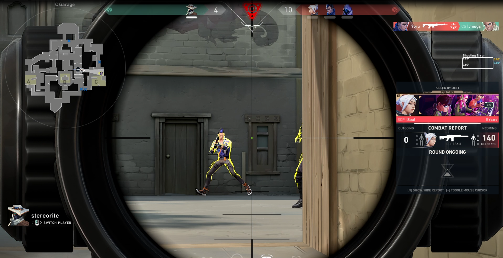
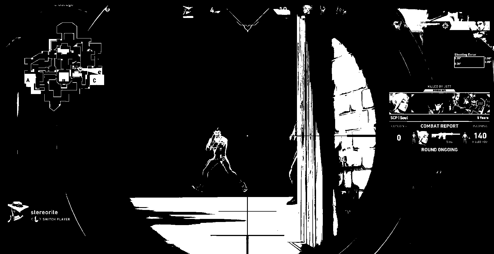
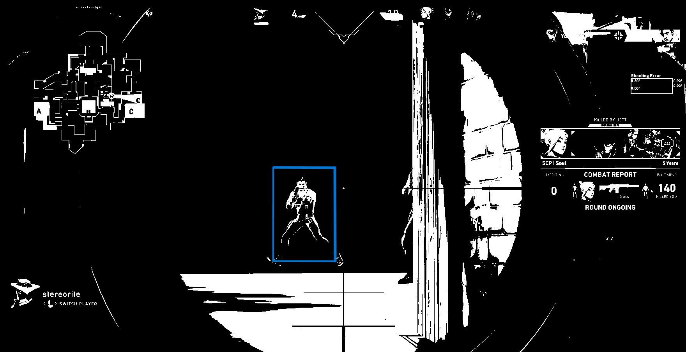
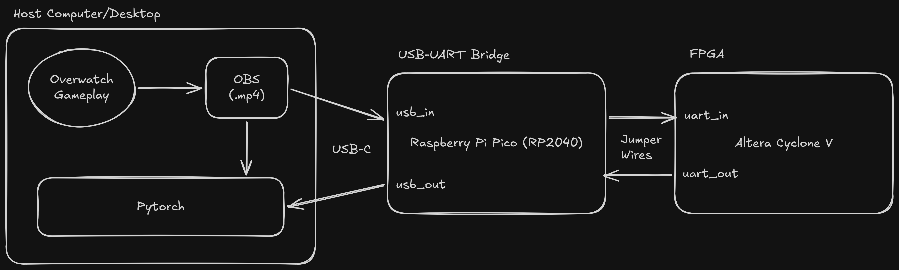
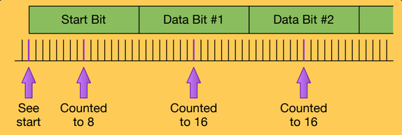
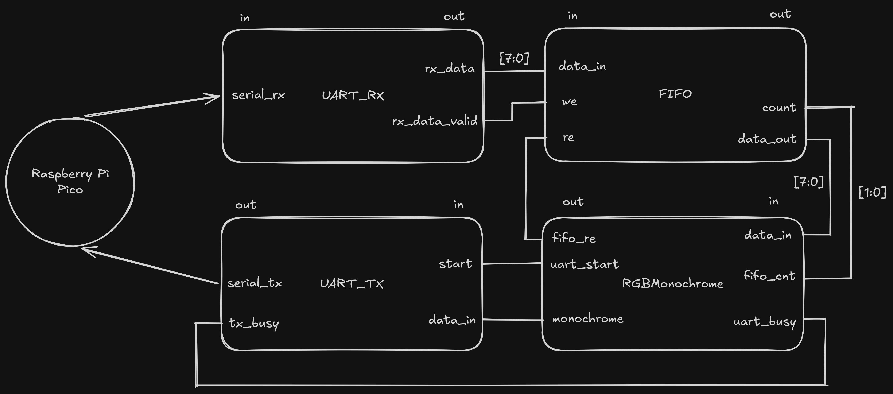
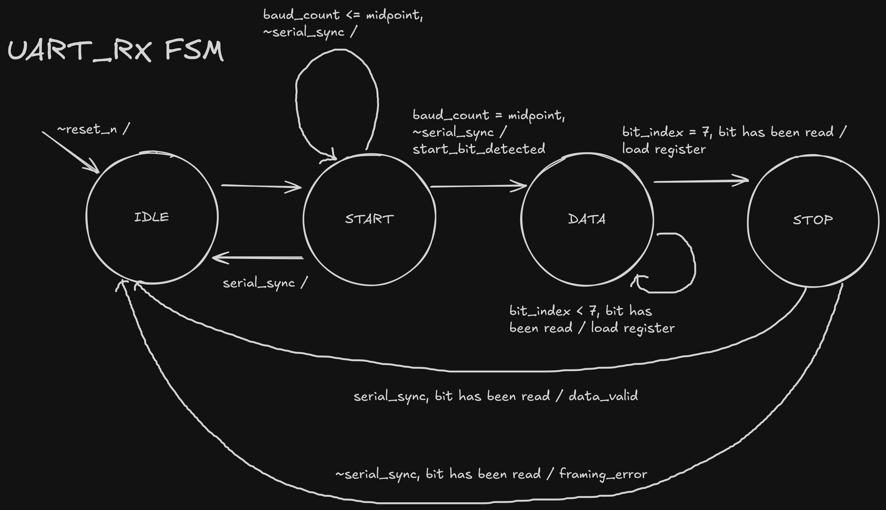
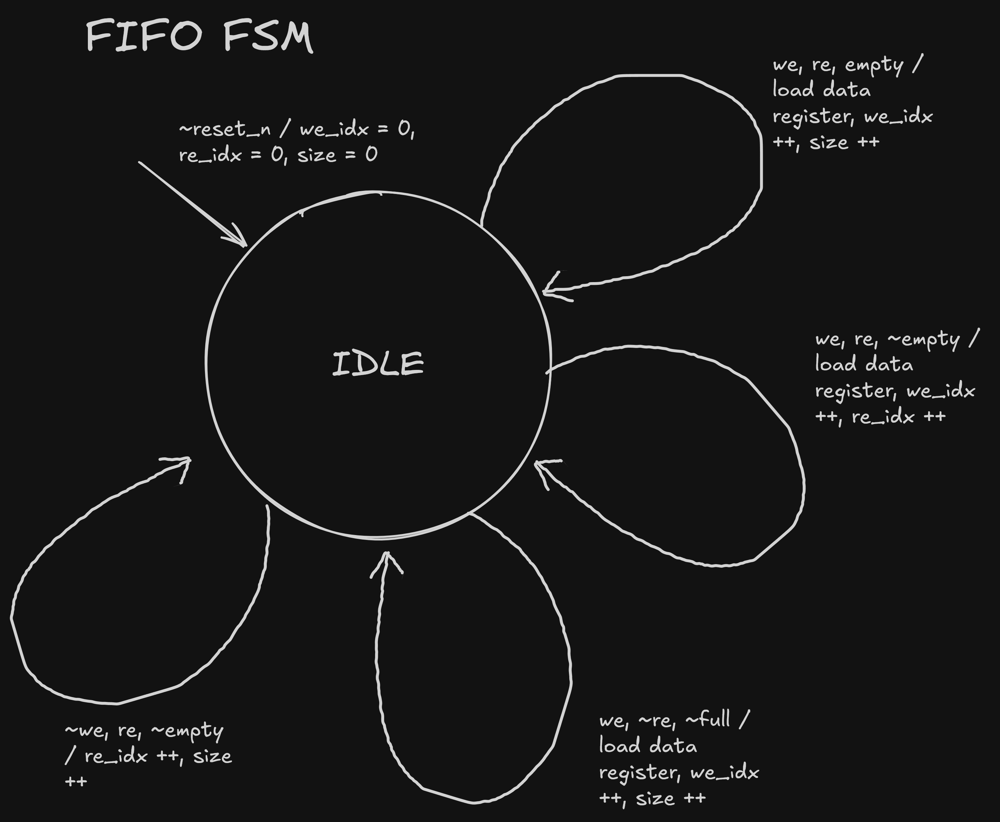
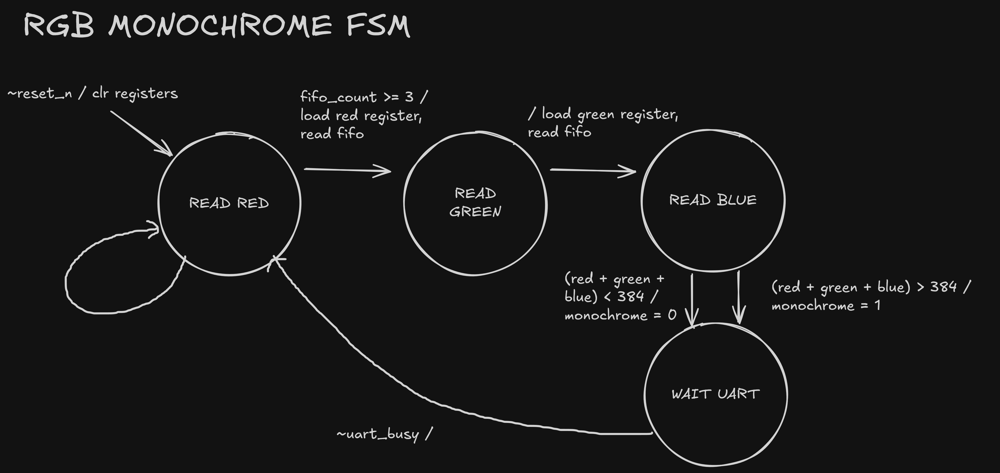
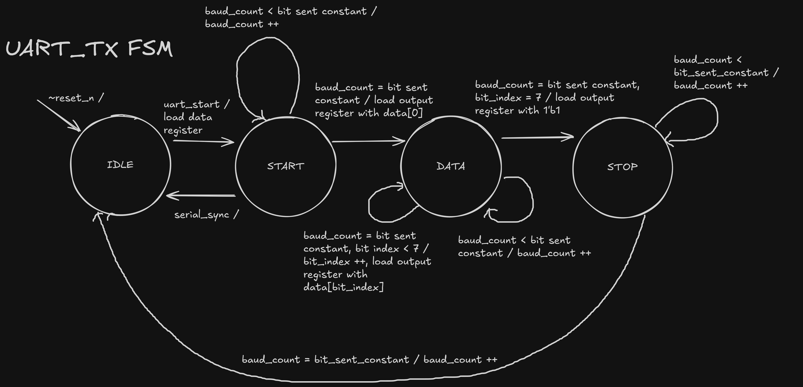

# Video Game FPGA Image Accelerator

This project implements an image filtering accelerator onto the FPGA, which takes frames from 1080p, 60 fps gameplay and applies a 1-bit monochrome filter to be analyzed by PyTorch. Currently, the PyTorch framework is not implemented for bounding boxes, but the basic sending logic from the Host -> Raspberry Pi Pico -> FPGA is complete.

## File contents
1. top.sv: Chip Interface for Altera DE0-CV (Cyclone V) FPGA.
2. uart.sv: Sending/receiving protocol logic for UART (Rx, Tx).
3. rgb_monochrome.sv: 1-bit monochrome filtering algorithm module.
4. library.sv: FIFO, Synchronizer, Flip Flop, Seven Segment combinational logic.
5. tb_uart.svL: (GENERATED BY CHATGPT) Testbench to test UART_RX module.
6. quartus/: Folder used for Quartus project file for programming Altera DE0-CV.
7. code.py: Microcode uploaded to RP2040 (Raspberry Pi Pico), random testing.
8. [example.mp4](https://drive.google.com/file/d/1TmG4NI_Xpf2G93dg6NbSs2j2WAseA-bl/view?usp=sharing): Example 1080p, 60 fps video game screen capture.

## Devices
1. Altera DE0-CV FPGA
2. Adafruit QT Py RP2040 (mimicing Raspberry Pi Pico)
3. Host Computer

## Results
Currently, the framework is able to take in a frame, manipulate it to be monochrome, and send it back to the host. The monochrome algorithm implemented on the FPGA will be discussed below.

The goal of this framework is for the FPGA to perform the filtering quickly so that, in the future, a PyTorch framework can create the bounding boxes surrounding enemies in games.

### Before FPGA:

### After FPGA:

### Future (PyTorch w/ dataset based ML):

## Implementation

### Architecture

From the left to right, the host connects to the Pico using USB-C, with the host sending RGB pixel data from a designated frame onto `COM3`. The Pico then sends information COM3, and encodes each RGB value into three individual 8-bit packets (one for red, one for green, one for blue). Each packet is then sent onto its UART `Tx` pin.

A jumper wire connects the Pico's `Tx` pin to `GPIO_0[0]` of the FPGA. UART is set up for this project such that the only relevant packet is the data packet. This means that we only care about the start bit (1 bit, active low), the data bits (8 bits), and the stop bit (1 bit, active high). There is no NRZ encoding/decoding, or bit stuffing done for this implementation of the UART protocol on the PICO. There are also no parity bits or checksums to ensure the validity of data. The communication is full-duplex (meaning transmission and recieving on the Pico is possible at same time). Currently, there is no `req`/`ack` handshake between UART and the FPGA, so the process flow is turning on the FPGA first before the Pico is on (which, I know, is not ideal).

After the FPGA actively monitors `GPIO_0[0]` until it detects the start of a packet/frame. The FPGA first looks for a falling edge, and ensures that the data on `GPIO_0[0]` is continously low (`1'b0`) up until the end of the middle of the start bit period of the UART frame. We don't read until the endpoint of the bit period, since we want to check the value of a bit for every midpoint of that bit's interval to ensure we are never out of bounds (see the image below).

*Sourced from 18-341 Lecture 13, Clock Domains from Prof Bill Nace @ CMU*

We can calculate how the FPGA "knows" the number of clocks within each bit transmitted in a UART frame. The clock frequency is 50 MHz. The baud rate of the Pico is 115200. Note that for UART, baud rate is equivalent to bit rate, since each UART symbol carries one bit.

So if we divide the clock frequency by the baud rate, we get the number of clocks per bit, called `CLOCKS_PER_BIT` in `uart.sv`. After `baud_count` equals `CLOCKS_PER_BIT - 1`, then we know the number of clocks we need to wait for a bit.

After the start bit is detected, each data bit is read, and the stop bit is also read. If the stop bit is valid.

The RGB Monochrome module reads the FIFO when it has a size of 3 elements (representing red, green, and blue pixel values). It then pops all 3 elements from the FIFO into it's own registers, and checks whether or not all of these 8-bit values added together exceeds a "gray" threshold (set to `10'd384`, which is RGB of standard gray added together). If it exceeds the threshold, the output is a 1-bit value asserted to `1'b1` representing white, otherwise it is set to `1'b0` representing black. 

(The rationale behind using 1-bit monochrome values is that there are over 2 million pixels in a 1080p frame. Assuming 1 byte per pixel value (red, green or blue), then that would be 6.22 MB for a single frame (more than the FPGA can hold/Pico can process). If instead the FPGA only cares about the monochrome data, then 1 bit (white or black) replaces 3 bytes of information, meaning 2.07 Mbits of information (which can be stored onto the FPGA). Although the design is already pipelined such that it is possible to process and manipulate RGB values on the FPGA, this sets up the possibility of storing an entire frame on the FPGA to perform additional responsibilities (such non-ML edge detection). I plan to implement Floyd-Steinberg's monochrome algorithm in the future, which should work well with an entire frame of information instead of a pixel at a time.)

The RGB Monochrome module then sends this information to the UART_TX module only when data is not already being transmitted. The UART_TX module, when data is ready to be sent, spends 10 bit periods sending the start bit, data bits (representing `8'b0` or `8'b1`), and the stop bit. This is sent via another jumper wire connecting `GPIO_0[1]` of the FPGA to the `Rx` pin of the Pico.

### UART Datapath

### UART RX FSM

### FIFO FSM

### RGB Monochrome FSM

### UART TX FSM
